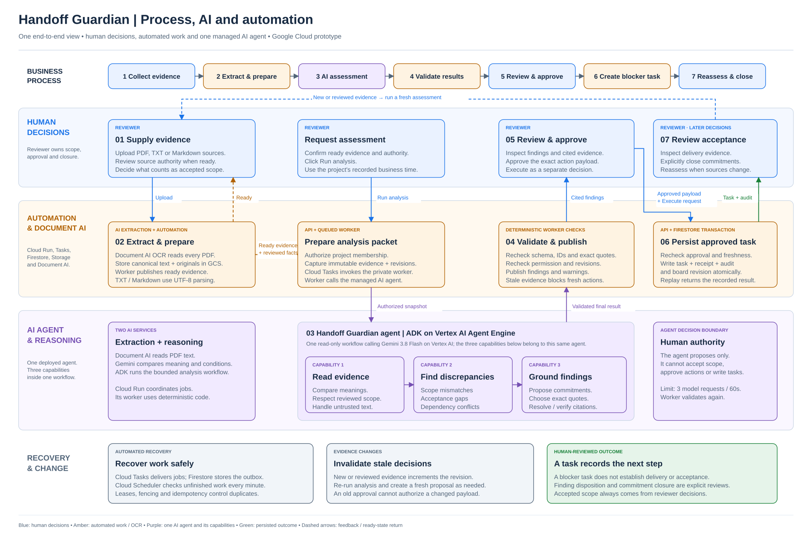

# Handoff Guardian — Evidence before assurance

**An AI-assisted review workspace for delivery managers preparing an IT project handoff.** Handoff Guardian compares what was promised, what was agreed and what the available evidence proves. It surfaces discrepancies with exact source citations, then lets a reviewer approve and separately execute a blocker task.

**[Open the live Google Cloud prototype](https://hg-web-622303555908.us-central1.run.app)**

| Review resource | Availability |
| --- | --- |
| Live application | Deployed; use the pre-registered judge account supplied in the presentation deck |
| Three-minute demo video | Pending — link has not yet been supplied |
| Public GitHub repository URL | Pending — link has not yet been supplied |
| Process and AI diagram | [Single-page preview](docs/diagrams/handoff-guardian-process-ai-automation.svg) |

The prototype uses Google Cloud for every hosted capability. Deployment, real PDF processing and a successful managed Gemini diagnostic have been observed. The complete successful assessment-to-approved-task journey still requires end-to-end verification; see [verification status](#verification-status).

## The problem: a completed checklist is not acceptance evidence

Project promises, signed scope, dependency plans and test results often live in different documents. Delivery managers must reconcile them manually before committing to a handoff. A board marked “Complete” can hide a scope dispute or a missing acceptance test.

Handoff Guardian helps a reviewer connect those documents while preserving two distinctions: **a promise is not automatically accepted scope**, and **a created task is not proof of delivery**.

### Worked example: Harbour Services staff portal

This example is fictional and uses the supplied synthetic development data.

| Source | What it says | Review question |
| --- | --- | --- |
| Presales email | Microsoft Entra ID SSO is promised for the 26 October launch. | Has that promise been incorporated into accepted scope? |
| Signed scope document | Launch uses password login; SSO is scheduled for phase two on 16 November. | Which scope has the reviewer accepted as authoritative? |
| Readiness checklist | Login readiness is “Complete,” with password-login testing recorded. | Where is the evidence of SSO acceptance? |
| Dependency plan | Tenant credentials and security approval are planned after launch. | If SSO is required at launch, can its prerequisites be met? |

The AI can explain these relationships even when documents use different wording. Its output remains a proposal for review. A file titled “Signed scope” or a statement inside a fixture does not assign authority in the application; the reviewer must do that explicitly.

## Review the prototype

### Access

Open the live application and **sign in using the pre-registered judge account supplied in the submission presentation deck**. Judges do not need to register. The submitter prepares email verification and reviewer project membership before review. If the assigned project is not visible, contact the submitter to check access. Actual judge credentials are not included in this README.

Use a project assigned for evaluation. Uploads and review decisions persist in Firestore, so use synthetic evidence rather than customer information. The interface labels the project's simulated business date; it is separate from real authentication and audit time.

### Walkthrough and expected behavior

The following is the implemented review flow, not a claim that every step has passed live acceptance testing.

1. **Upload evidence.** In **Sources**, choose **Upload source**. PDF, Markdown and text are supported. Wait until each active source is ready; pending or failed ingestion blocks analysis.
2. **Review source authority.** Inspect the original and extracted text. Classify the source appropriately, such as accepted baseline, proposal, context or acceptance evidence. Uploading a newer file does not supersede an accepted source automatically.
3. **Request analysis.** On **Overview**, select **Run analysis**. The server captures an authorized evidence snapshot and queues the managed agent workflow.
4. **Inspect findings.** Review the explanation, exact cited passages, source versions and coverage warnings. Findings are limited to scope mismatch, acceptance gap and dependency conflict. Missing proof is qualified against the supplied packet, not asserted absent everywhere.
5. **Propose and approve a next step.** Select **Propose blocker task**, supply a project-member owner and review the exact proposal. **Approve exact proposal** records approval without creating a task.
6. **Execute separately.** Select **Create approved task**. The API rechecks identity, permissions and freshness before writing the task. Inspect **Project board** and **Audit history**. Task creation leaves finding disposition and commitment closure subject to separate review.

To explore changing evidence, upload or review another source version and request a fresh assessment. Older proposals with changed evidence bindings become stale and require a new review.

Use the [judge-ready demo files](fixtures/demo-upload/): [scope PDF](fixtures/demo-upload/01-harbour-scope.pdf), [launch email](fixtures/demo-upload/02-launch-email.md), [readiness checklist](fixtures/demo-upload/03-readiness-checklist.md) and [dependency plan](fixtures/demo-upload/04-dependency-plan.md). The [upload details CSV](fixtures/demo-upload/upload-details.csv) is a metadata reference, not an evidence file to upload. The PDF exercises Document AI; the three Markdown files use direct text ingestion. No PDF generation or development-tool installation is needed for judges. See the [fixture guide](fixtures/README.md#judge-demo-use-the-ready-to-upload-files). Fixture source IDs and offsets are not reused for uploaded documents.

## Where AI, automation and people contribute

| Responsibility | Contribution |
| --- | --- |
| **Document AI** | Extracts PDF text and page anchors using the configured OCR processor version. Markdown and text use UTF-8 parsing. |
| **One ADK agent using Gemini** | Compares promises, scope, requirements and dependencies semantically; proposes commitments and three finding types; selects exact evidence quotes. |
| **Deterministic automation** | Authorizes access, resolves quotes to Unicode code-point spans, validates references, queues work, checks freshness and persists approved tasks transactionally. |
| **Reviewer** | Decides source authority and accepted scope, reviews findings, approves the exact action, executes it separately and reviews acceptance evidence for closure. |

All application Gemini inference runs inside **one read-only ADK workflow on Vertex AI Agent Engine**, using Gemini 3.8 Flash on Vertex AI. The Cloud Run worker coordinates jobs; it is not another agent runtime. The agent has no task-write, approval or authority-changing tools.

The agent validates its output, and the worker independently validates the final result before publication. Missing, ambiguous or unknown-source citations are rejected. Bounded repair allows at most three model requests within a 60-second invocation budget; it does not substitute canned output after failure.



Editable diagrams: [single-page process, AI and automation](docs/diagrams/handoff-guardian-process-ai-automation.drawio) · [solution architecture, workflow and operations](docs/diagrams/handoff-guardian-solution-architecture.drawio). Open the `.drawio` files in draw.io / diagrams.net.

## Google Cloud architecture

| Layer | Services and role |
| --- | --- |
| Web and API | Next.js/TypeScript web app and FastAPI/Python API on separate Cloud Run services |
| Identity | Identity Platform verified email/password sign-in; server-controlled user binding and project membership |
| Evidence | Private Cloud Storage for generation-pinned originals, canonical text, OCR output and analysis snapshots/results |
| State and actions | Firestore for memberships, revisions, jobs, findings, approvals, tasks, idempotency results and audit events |
| Document processing | Document AI Enterprise Document OCR for PDFs |
| Generative analysis | ADK on Vertex AI Agent Engine, calling Gemini on Vertex AI |
| Durable automation | Cloud Tasks invokes the IAM-protected worker; Firestore outbox and leases support recovery; Cloud Scheduler runs recovery every minute |
| Delivery and operations | Cloud Build, Artifact Registry, Terraform, attached service accounts, Cloud Logging and Monitoring |

The recorded deployment is in `qnova-ai-builder`: compute, Firestore and evidence storage use `us-central1`; Document AI processing and Gemini inference use `us`. Secret Manager is enabled, with no configured runtime secret required by this deployment. Runtime identities use attached service accounts rather than downloaded keys.

Task, execution result, board revision and audit event are written in one Firestore transaction. Durable state handles duplicate requests and queue deliveries. This does not guarantee exactly-once inference or eliminate duplicate model costs after an ambiguous failure.

## Verification status

The following summarizes observations recorded during prototype development on **18 October 2026**. It is not a fresh acceptance run, and the original cloud reports are not included in this checkout.

| Area | Recorded result |
| --- | --- |
| Deployment | Three Cloud Run services and the managed agent deployed; deployment acceptance passed; worker rejected unauthenticated invocation. |
| Identity and PDF ingestion | Existing reviewer email verified and membership provisioned; four uploaded sources became ready, including a one-page PDF processed by Document AI. |
| Managed Gemini diagnostic | An isolated, authorized snapshot replay produced two findings, two proposed commitments and two warnings. An unknown-source reference was rejected on request one; targeted repair succeeded on request two. Both agent and independent worker validation passed. |
| Application publication and reviewed task | A fresh successful application assessment followed by a human-approved persisted task remains unverified in the recorded live journey. The diagnostic did not publish an application assessment or create a task. |
| Interface | Deployed sign-in, registration and reset views inspected on desktop and mobile. A complete signed-in review/task browser walkthrough remains unverified. |
| Accuracy and impact | No independent holdout accuracy, reviewer-time improvement or cost-per-analysis benchmark has been measured. |

Recorded Cloud Build results: **94 backend tests** (including eight native Firestore-emulator checks), **33 operator/infrastructure tests**, **22 frontend unit tests** and **six browser checks** passed for the application release. A later agent-only update passed **53 agent tests**. These are historical results, not a claim that the reduced checkout currently reproduces every suite.

The [synthetic fixtures](fixtures/README.md) are development data. Expected labels, canned responses and foreign-project decoys are test-only and never enter the deployed agent packet. Fixture correctness is not live model accuracy. Operational calls are usage-based; bounded retries and budget notifications are controls, not a verified cost estimate or spending cap.

## Source guide for technical review

Supporting component guides: [AI agent](agent/README.md) · [API and private worker](backend/README.md) · [reviewer web application](frontend/README.md) · [Google Cloud infrastructure](infra/terraform/README.md). These provide optional technical detail after the judge walkthrough above.

| Location | What to inspect |
| --- | --- |
| [frontend/components/guardian.tsx](frontend/components/guardian.tsx) | Evidence, findings, exact proposal review, separate approval/execution and task-board UI |
| [frontend/components/identity-panel.tsx](frontend/components/identity-panel.tsx) | Registration, verification and password-reset experience |
| [backend/src/handoff_guardian/](backend/src/handoff_guardian/) | API authorization, domain rules, durable worker jobs and Google Cloud adapters |
| [agent/src/handoff_agent/](agent/src/handoff_agent/) | ADK workflow, instructions, structured output, exact quote resolution and safe repair diagnostics |
| [contracts/openapi.yaml](contracts/openapi.yaml) | Public API and domain schemas |
| [infra/terraform/](infra/terraform/) | Cloud services, IAM boundaries, indexes, monitoring and example configuration |
| [cloudbuild.yaml](cloudbuild.yaml) | Test, image-build and deployment pipeline definition |
| [fixtures/](fixtures/) | Synthetic scenarios and offline regression material |

## Developer setup and checks

Use **Node.js 24, Python 3.12 and uv** with the committed npm/uv lockfiles. For infrastructure validation, use Terraform compatible with [the provider requirements](infra/terraform/versions.tf). On Windows, use `npm.cmd` if PowerShell blocks the npm wrapper. Run these commands from the repository root:

```sh
npm --prefix frontend ci
uv --directory backend sync --frozen
uv --directory agent sync --frozen

npm --prefix frontend run lint
npm --prefix frontend run typecheck
npm --prefix frontend run test
npm --prefix frontend run build
uv --directory backend run ruff check .
uv --directory backend run pytest
uv --directory agent run ruff check .
uv --directory agent run pytest
```

The backend Firestore transaction tests skip unless a running Google Firestore emulator is configured through `FIRESTORE_EMULATOR_HOST` **in the test process only**. A skipped check is not a pass. Deployed startup rejects emulator settings and test providers.

For frontend browser checks, install Chromium and run against the production build created above:

```sh
cd frontend
npx --no-install playwright install chromium
npm run test:e2e
```

For a local interface preview, run `npm --prefix frontend run dev` from the root. Configure public browser values in `frontend/.env.local` using the names in [.env.example](.env.example). Without configuration, the UI shows an explicit setup state; it does not provide fake sign-in or a canned workspace. Working cloud-backed development also requires authorized Google resources, approved ADC and the protected backend configuration.

### Reproduction limitations in this checkout

The repository includes deployment, bootstrap, fixture-validation and evaluation helpers under [scripts/](scripts/). However, the original starter-pack specification and harness documents are absent. The cloud-pack validator used by `cloudbuild.yaml` still requires those files, so full CI artifact validation needs to be reconciled with the submission checkout before that pipeline can be reproduced successfully. The [infrastructure guide](infra/terraform/README.md#operator-deployment-handoff-and-current-gaps) explains the handoff and current gaps. Local component tests do not replace real cloud acceptance.

The application source, contracts, dependency lockfiles, Terraform definitions and diagrams remain available for review. This README does not claim that a fresh clone can currently recreate the deployed environment end to end. Credentials, private Terraform state and judge passwords must remain outside the repository.
